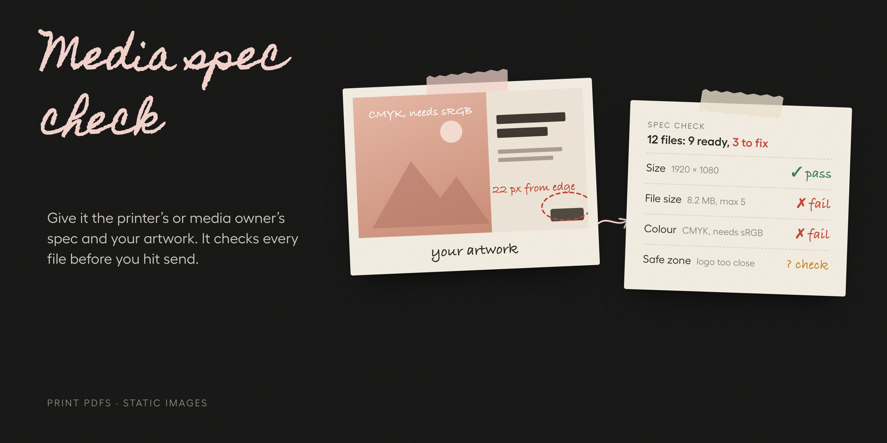

# Media spec check

**A Claude skill that checks your artwork against the printer's or media owner's spec, before you hit send.**

> 📌 **Static artwork only (version 1).** Print PDFs and static images (JPG, PNG). Video and motion aren't checked yet. They're coming in version 2.

---

## The problem

Artwork can look perfect on screen and still be wrong. It might be the wrong physical size, RGB instead of CMYK, too low-res, or flattened into a single image. You usually find out when the printer or media owner bounces it back. Or worse, when it's already up on the board.

And the spec you're checking against is rarely tidy. It's split across a web page and a PDF, it's missing half the details, and it might be last year's version.

I built this after a client's hoarding boards came out of my design file at a third of their real size. Nothing looked wrong on screen. A two-minute check would have caught it.

## What it does

Give Claude the **spec** (a PDF, a web link or pasted text) and your **files**. The skill:

1. **Reads the spec** and combines it into one table, showing where each rule came from. If the website and the PDF disagree, it shows you both and lets you decide.
2. **Checks the spec is current.** If there's no date, or it's more than 6 months old, it tells you to confirm with your contact.
3. **Asks you to confirm the table** before checking anything, because a misread spec gives a confident wrong answer.
4. **Checks every file** and gives you a pass/fail report with the exact fix for each problem.

When the spec leaves something out, it tells you to check with your contact and gives the industry default as a fallback. It also writes the question for you to send.

**It checks. It never sends.** Submitting the files stays with you.

## What the report looks like

> **12 files checked: 9 ready to send, 3 need fixing.**
> Checked against: Example Outdoor Co., Roadside Digital spec v4, dated 12 Aug 2026, from the sales rep (PDF).

| Check | Spec | Your file | Result |
|---|---|---|---|
| Size | 1920 × 1080 px | 1920 × 1080 px | ✅ Pass |
| File size | Max 5 MB | 8.2 MB | ❌ Fail |
| Colour | sRGB | CMYK | ❌ Fail |
| Safe zone | 50 px from edges | Logo 22 px from right | ⚠️ Check |

Every report ends with **Not checked** (so a pass never means more than it should) and **Questions for your contact** (every gap in the spec, in one message ready to paste).

## What it checks

| Print (PDF, AI) | Static digital (JPG, PNG) |
|---|---|
| Physical size and aspect ratio | Exact pixel size and orientation |
| Bleed and trim | File type and file size |
| CMYK vs RGB and spot colours | Colour profile (sRGB vs CMYK or wide-gamut) |
| Image resolution at print size | Transparency |
| Live text vs outlined, embedded fonts | Safe zone (visual check) |
| Black values (rich black vs K100) | Static vs animated |
| Live transparency | |
| PDF/X-4, file size and type | |

It also looks for the mistakes that catch people out, like a document set up in pixels instead of mm, or artwork flattened into one low-res image on export. It works the same whether the file came from Affinity, Figma, Illustrator, Canva or anything else.

## How to install

You don't need to be technical.

**In the Claude app (claude.ai or desktop):**
1. Download this repo: click the green **Code** button, then **Download ZIP**.
2. In Claude, go to **Settings → Capabilities → Skills** and upload the `media-spec-check` folder (zipped).
3. Start a chat, attach your spec and your artwork, and ask: *"Check these against the spec."*

**In Claude Code:**
Copy the `media-spec-check` folder into `~/.claude/skills/`. Then ask Claude to check your files.

**What it needs:** Python, plus two free libraries (`pikepdf` for PDFs and `pillow` for images). The Claude app already has them. On your own computer, Claude will ask before installing them. You don't need any print or prepress software.

## Who it's for

Designers and marketers who send artwork to printers and media owners but aren't production specialists. That includes freelancers, in-house brand teams and small agencies without a studio manager to check files.

## Limits

- **Static only.** No video or motion yet.
- **It checks the file, not the design.** It won't tell you if the headline is weak.
- **Some things need your eyes.** Text size after outlining, and safe zones, are flagged for a visual check.
- **Product templates** (cut-outs, drill holes) can't be checked without the template file.
- **It can't know a spec is the latest version.** It flags old or undated specs, but your contact has the final word.

## Roadmap

- [ ] Version 2: video and motion (length, frame rate, codec, audio, file size)

---

Made by [Kim Lee](https://kimmlee.com), an AI creative who builds tools for brand and creative teams.
